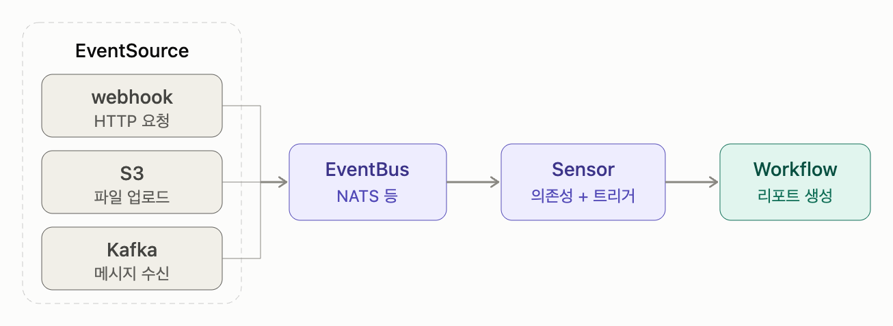
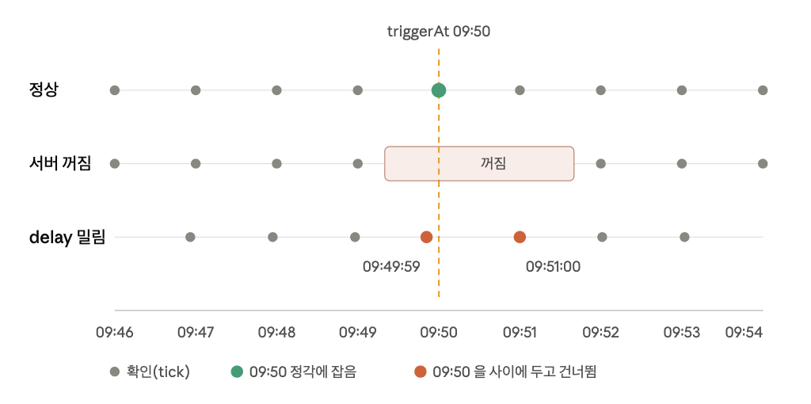
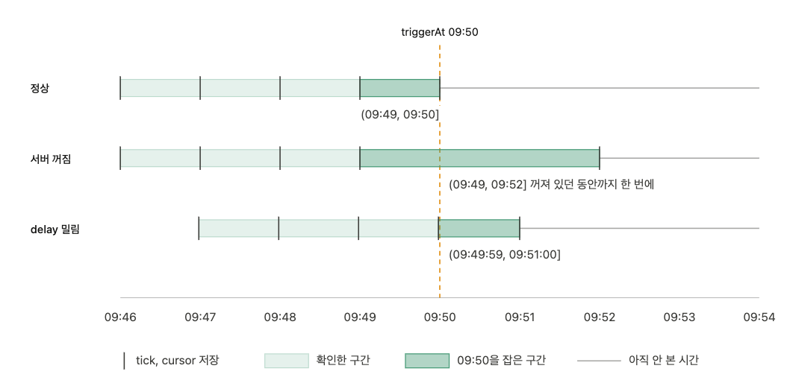
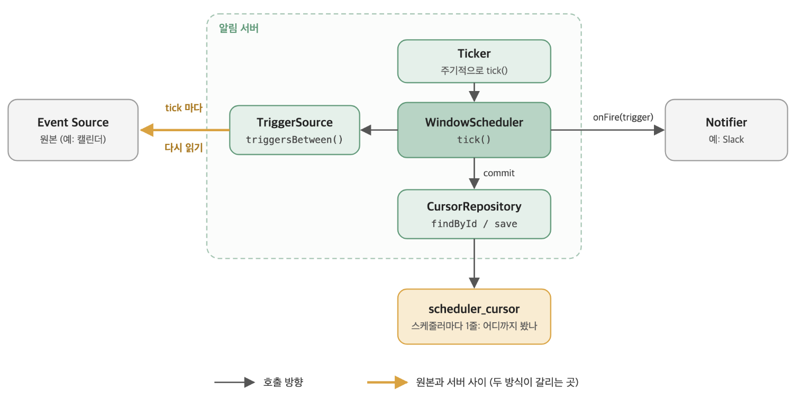
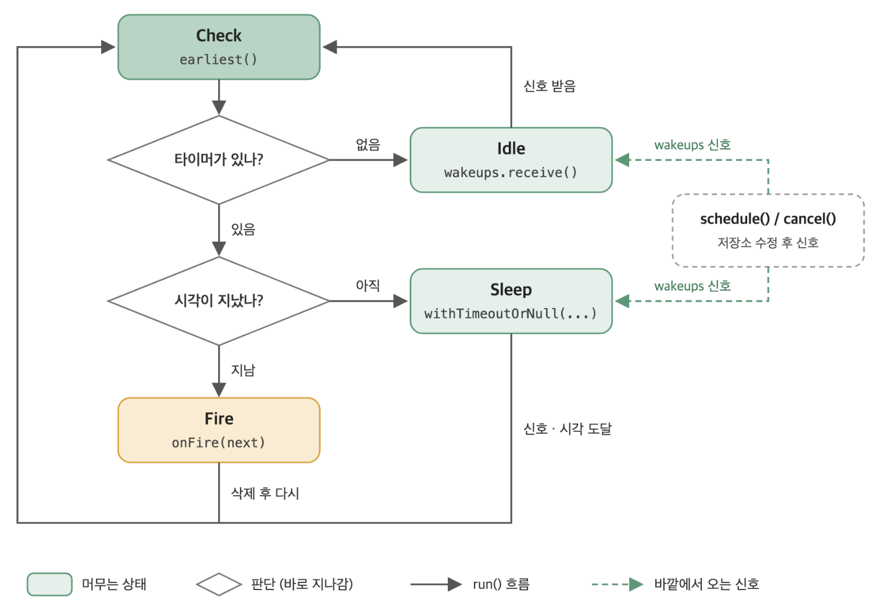
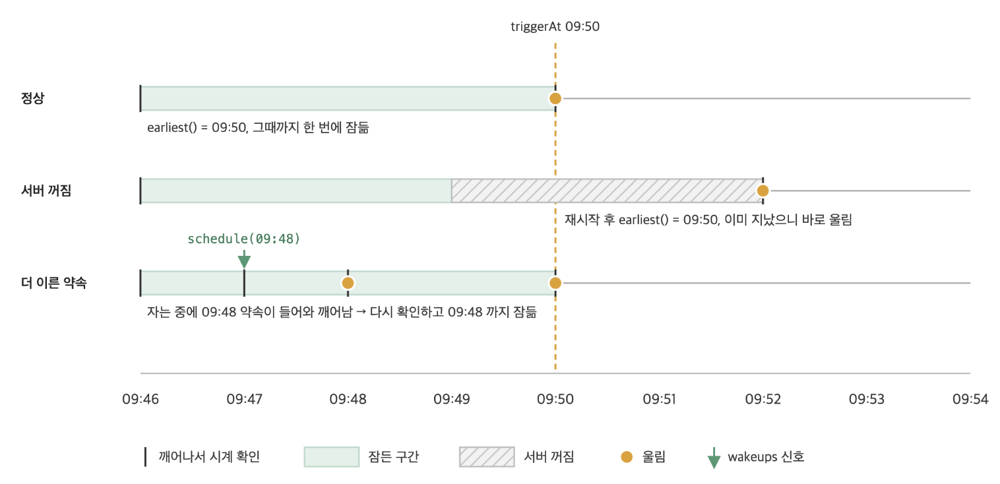
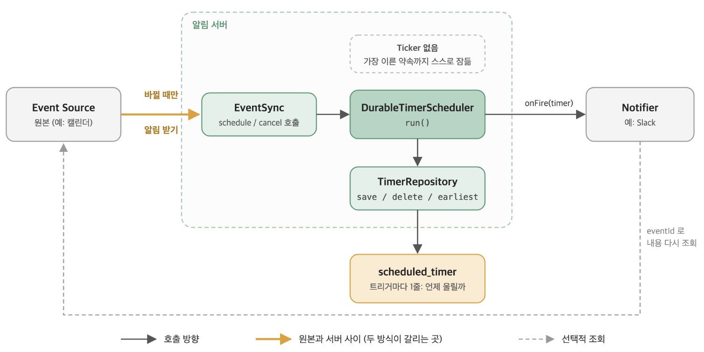

## 들어가며 - 그 시각에 아무도 깨어 있지 않다면

Argo Events 는 k8s 위에서 "무슨 일이 생기면 이걸 실행해!" 를 선언하는 도구입니다. 큰 구조는 다음과 같습니다



EventSource 가 바깥 이벤트를 듣고, EventBus 가 이벤트를 전달하고, Sensor 가 규칙에 맞는 이벤트를 받아 Workflow 를 실행합니다.

여기에 있는 EventSource 들에는 바깥에서 밀어준다(Push)는 공통점이 있습니다. Webhook 은 호출이 와야 움직이고 S3 / Kafka 도 무언가 들어가야 반응합니다. 즉 이벤트가 언제 일어날지는 EventSource 가 알 필요가 없고 그냥 기다리기만 하면 됩니다.

그런데 Cron Job 과 같은 EventSource(Argo Events 에서는 `calendar` 라는 이름입니다)는 다릅니다. "지금이 그때" 라는 것을 알아야 합니다. "매일 09:00" 와 같은 스케줄로 이벤트를 만드는데, 이건 아무도 밀어주지 않고, 09:00 가 되었다는 사실을 알려줄 외부 시스템이 없습니다. **EventSource 가 스스로 시계를 보고 "지금이니?" 를 판단해야 합니다.**

그래서 이런 질문이 생깁니다

> 매일 09:00 에 리포트 워크플로우를 걸어놨다. <br/>
> 어느날 08:55 에 EventSource pod 가 재시작됐고, 09:03 에 다시 올라왔다. <br/>
> 이때 09:00 워크플로우는 돌았을까 ?

- 쿠버네티스 CronJob도 결국 어떤 컨트롤러 프로세스가 시계를 보고 Job을 만든다. 그 프로세스가 업그레이드로 잠깐 내려가 있었다면?
- "회의 10분 전에 Slack으로 알려주는" 봇을 만들었다. 배포하느라 서버가 잠깐 꺼져 있던 사이에 알림 시각이 지나갔다면? 그 사이에 누가 회의 시간을 30분 미뤘다면?

시간을 다루는 시스템은 결국 전부 같은 질문을 마주칩니다. <br/>

> **스케줄러는 '지금이 그때'라는 걸 어떻게 아는가. <br/>그리고 그때 깨어 있지 않았다면 어떻게 되는가?**

처음 떠오르는 답은 단순합니다. 트리거 되어야하는 그 시각($t$) 까지 남은 시간을 계산($t-t0$)해서 타이머를 걸면 된다.

하지만, 이 방법은 생각보다 쉽게 깨집니다.

<br/>

먼저 예시를 하나 들어보겠습니다. <br/>
구글 캘린더를 보고 회의 시작 10분 전에 알림을 보내는 기능입니다.

이 경우 제약은 다음과 같습니다

1. 회의 시각은 바뀌거나, 새로 생기거나, 취소될 수 있습니다.
2. 알림 서버는 배포나 장애로 잠깐 꺼질 수 있습니다.

:::info
실제로는 "같은 알림을 두 번 보내지 않기", "회의가 이미 시작한 뒤에 온 알림은 버리기" 도 필요합니다. <br/>
하지만 두 방식 모두 같은 방법으로 풀기때문에 다루지 않습니다
:::

<br/>

## 1. In-memory Timer - 그 시간에 깨워줭..

일단 제약은 잠시 잊고, 가장 단순한 구현부터 만들어 보겠습니다. <br/>
회의가 있고, 그 회의의 "N분 전"이 하나의 트리거가 됩니다.

```kotlin
data class CalendarEvent(
  val id: String,
  val title: String,
  val startAt: Instant,
)

data class CalendarEventTrigger(
  val event: CalendarEvent,
  val offset: Duration, // N분 전
) {
  val triggerAt: Instant = event.startAt.minus(offset)
}
```

현재 시간부터 `triggerAt` 까지 남은 시간을 계산해서 타이머를 걸면 됩니다.

```kotlin
fun CoroutineScope.scheduleTrigger(trigger: CalendarEventTrigger, onFire: (CalendarEventTrigger) -> Unit) = launch {
  val remaining = Duration.between(Instant.now(), trigger.triggerAt)

  delay(remaining.toMillis().coerceAtLeast(0))
  onFire(trigger)
}
```

얼핏 보면 잘 돌아갈 것 같습니다. <br/>
하지만, 이 코드는 **남은 시간을 한 번 계산하고, 그 뒤로는 시계를 다시 보지 않습니다**

때문에

1. 회의 시각이 바뀌면, 이미 걸어둔 타이머는 여전히 이전 시각을 기준으로 남은 시간을 기다립니다.
2. 알림 서버가 배포나 장애로 잠깐 꺼지면, 타이머는 사라집니다

<br/>

## 2. SweepLine 방식 - '지금이니?!' 대신 '그 사이에 있었니?'

In-memory Timer 의 근본적인 문제는 **시계를 한 번만 봤기 때문**이었습니다. <br/>
그러면 시계를 계속 보면 되지 않을까요 ?

### 2-1. 계속 물어보기

타이머를 거는 대신, 1분마다 깨어나서 "지금 울릴 트리거가 있니?" 를 물어보는 방식입니다.

```kotlin
suspend fun pollEveryInterval(calendar: CalendarClient, onFire: (CalendarEventTrigger) -> Unit) {
  while (true) {
    val now = Instant.now().truncatedTo(ChronoUnit.MINUTES)

    calendar.triggers()
      .filter { trigger -> trigger.triggerAt == now }
      .forEach { trigger -> onFire(trigger) }

    delay(60 * 1000L)
  }
}
```

그런데 `trigger.triggerAt == now` 가 문제입니다. 이 조건은 **정확히 그 순간에 깨어 있어야만** 참이 됩니다

- 서버가 09:49 ~ 09:51 동안 꺼져 있었다면, 09:50 을 묻는 순간이 아예 없습니다
- 꺼지지 않았더라도, `delay` 가 조금씩 밀려 09:49:59 다음에 09:51:00 에 깨어나면 09:50 을 건너뛰어버립니다



물어보는 횟수를 늘렸을 뿐, 여전히 **"지금이 그 시각이니?"** 라는 같은 질문을 하고 있습니다.
그 시점을 맞히려고 하는 한, 지나칠 때 깨어 있지 않으면 놓칩니다.

### 2-2. 점이 아니라 구간을 보기

계속 물어보는 방식의 문제는 **정확히 그 순간에만 깨어 있어야 잡을 수 있다** 는 것이었습니다. <br/>
그러면 그 순간을 맞히려 하지 말고, **지나간 구간을 돌아보면** 어떨까요 ?

> **지난번에 확인한 뒤로 지금까지, 그 사이에 울렸어야 할 트리거가 있었니?**

지난번에 어디까지 확인했는가? (Cursor) 를 기억하고, 이번에 확인할 때는 그 사이에 울렸어야 할 트리거를 모두 가져오는 방식입니다



```kotlin
@Entity
class SchedulerCursor(
  @Id
  val name: String,
  var position: Instant,
)

interface SchedulerCursorRepository : JpaRepository<SchedulerCursor, String>

interface TriggerSource {
  // triggerAt 이 (from, to] 구간에 있는 트리거를 모두 가져온다
  fun triggersBetween(from: Instant, to: Instant): List<CalendarEventTrigger>
}

class WindowScheduler(
  private val name: String,
  private val clock: Clock,
  private val cursorRepository: SchedulerCursorRepository,
  private val triggerSource: TriggerSource,
  private val onFire: (CalendarEventTrigger) -> Unit,
) {
  fun tick() {
    val now = clock.instant()
    val cursor = cursorRepository.findByIdOrNull(name)

    if (cursor == null) {
      cursorRepository.save(SchedulerCursor(name, now))
      return
    }

    if (!now.isAfter(cursor.position)) return

    triggerSource.triggersBetween(cursor.position, now)
      .sortedBy { trigger -> trigger.triggerAt }
      .forEach { trigger -> onFire(trigger) }

    // commit
    cursor.position = now
    cursorRepository.save(cursor)
  }
}
```

`WindowScheduler.tick()` 을 몇번을 부르든, 늦게 부르든 , 지난번에 확인한 시각 이후로 지금까지의 구간에 울렸어야 할 트리거를 모두 가져와서 처리합니다

앞에서 본 제약을 다시 떠올려보면,

1. 회의 시각이 바뀌더라도, 매 tick 마다 캘린더에서 트리거를 새로 계산합니다.
2. 서버가 잠깐 꺼져도 cursor 가 남아 있으니, 꺼져 있던 구간을 다음 tick 에서 한 번에 봅니다



<br/>

## 3. Durable Timer 방식 - '그 사이에 있었니?' 대신 '다음은 언제니?'

다만 sweepline 에도 대가가 있습니다 <br/>
트리거가 하루에 한 번 뿐이어도, tick 은 매 주기마다 캘린더를 조회해야합니다. <br/>
그리고 tick 간격만큼 늦게 울립니다. 09:50 트리거는 09:50과 09:51 사이 어딘가에서 울립니다.

그러면 반대로 울릴 시각을 미리 정해두고 그때만 깨어나되, 서버가 꺼져도 타이머가 사라지지 않게 할 수는 없을까요 ?

### 3-1. 위치 대신 '타이머'를 저장하기

SweepLine 의 cursor(어디까지 봤는가)도 저장소에 있었지만, 언제 울려야 하는지는 tick 마다 계산했습니다.

이번에는 **Trigger 마다 울릴 시각** 자체를 저장소에 기록해두고, <br/>
서버는 그중 가장 이른 타이머까지만 잠들고, 그 타이머가 울리면 다음으로 이른 타이머를 꺼냅니다.<br/>
재시작해도 타이머는 저장소에 남아 있으니, 다시 가장 이른 것부터 꺼내면 됩니다.

```kotlin
@Entity
class ScheduledTimer(
  @Id
  val key: String, // eventId:offset
  val triggerAt: Instant,
  val eventId: String,
  val offset: Duration,
)

interface ScheduledTimerRepository : JpaRepository<ScheduledTimer, String> {
  @Query(
    value = "SELECT * FROM scheduled_timer ORDER BY trigger_at LIMIT 1",
    nativeQuery = true,
  )
  fun earliest(): ScheduledTimer?
}
```

스케줄러는 가장 이른 타이머까지 잠듭니다. <br/>
자는 동안 더 이른 타이머가 들어오면, 타이머는 저장소에 넣고 잠든 스케줄러에게는 코루틴 `Channel` 로 "일어나!!" 라는 신호를 보냅니다

```kotlin
class DurableTimerScheduler(
  private val clock: Clock,
  private val timerRepository: ScheduledTimerRepository,
  private val onFire: (ScheduledTimer) -> Unit,
) {
  private val wakeups = Channel<Unit>(Channel.CONFLATED)

  fun schedule(timer: ScheduledTimer) {
    timerRepository.save(timer)
    wakeups.trySend(Unit)
  }

  fun cancel(key: String) {
    timerRepository.deleteById(key)
    wakeups.trySend(Unit)
  }

  suspend fun run() {
    while (true) {
      val next = timerRepository.earliest()

      if (next == null) {
        wakeups.receive()
        continue
      }

      val remaining = Duration.between(clock.instant(), next.triggerAt)
      if (remaining > Duration.ZERO) {
        withTimeoutOrNull(remaining.toMillis()) { wakeups.receive() }
        continue
      }

      onFire(next)
      timerRepository.deleteById(next.key)
    }
  }
}
```



타이머가 없으면 **Idle**, 가장 이른 타이머가 아직 미래면 **Sleep**, 이미 지났으면 **Fire** 상태로 전이하고,
어느 상태에서 빠져나오든 항상 **Check** 로 돌아와 다시 earliest() 를 뭅습니다

<br/>

얼핏 보면 In-memory Timer 처럼 남은 시간만큼 기다리는 코드지만,

1. 타이머가 메모리가 아니라 저장소에 있습니다. 서버가 재시작되면 저장소에서 다시 꺼내고, 꺼져 있는 동안 지나간 타이머는 `remaining` 이 0 이하라 바로 울립니다.
2. 깨어날 때마다 시계를 다시 봅니다. sweepline은 남은 시간을 한 번 계산하고 끝이었지만, 여기서는 깨어날 때마다 `earliest()` 와 `clock.instant()` 를 다시 확인합니다.
3. 더 이른 타이머가 들어오면 일찍 깨어납니다. sweepline 의 delay 한 번 걸면 끝까지 기다렸습니다.



### 3-2 회의 시각이 바뀌면 ?

저장소의 triggerAt 은 타이머를 저장하는 순간에 계산한 값입니다. 09:00 회의를 10시로 미뤄도, 저장소에는 여전히 08:50 이 적혀 있습니다. <br/>
SweepLine 은 tick 마다 캘린더를 다시 읽었기 때문에 이 문제가 없었지만, Durable Timer 는 캘린더를 다시 보지 않습니다.

그래서 변경이 발생하면 `schedule`, `cancel` 을 다시 부르고, <br/>
같은 회의의 알림은 같은 key 를 가지므로 시각이 바뀌면 기존 타이머를 덮어쓰고, 취소되면 지웁니다

하지만, 이 호출은 캘린더 webhook 이나 주기적인 동기화처럼 스케줄러 바깥에서 와야 합니다. 그리고 한 번이라도 놓치면 저장소의 타이머는 옛날 그대로 남습니다. <br/>
회의를 10시로 미뤘는데 알림을 놓쳤다면 08:50 에 엉뚱한 알림이 가고, 정작 09:50 에는 아무것도 오지 않습니다. <br/>
스케줄러 입장에서는 저장된 타이머대로 정확히 울린 것이라 에러도 나지 않습니다.



## 4. 정리하면

두 방식은 달라 보이지만, 사실 하는 일은 비슷합니다.

- SweepLine 은 깨어나서 "지난번 이후로 지나간 트리거" 를 꺼내고,
- Durable Timer 도 깨어나서 "이미 지난 타이머" 를 저장소에서 꺼냅니다

둘 다 깨어날 때마다 시계를 다시 보고, 지나간 것을 처리합니다

<br/>

진짜 차이는 "언제 울려야 하는가" 를 언제 계산하느냐 입니다.

- SweepLine 은 읽을 때 계산합니다. tick 마다 캘린더에서 트리거를 새로 뽑습니다.
- Durable Timer 는 쓸 때 계산합니다. 타이머를 저장하는 순간 triggerAt 이 정해지고, 그 뒤로는 저장된 값을 믿습니다

|                         | SweepLine                       | Durable Timer                          |
| ----------------------- | ------------------------------- | -------------------------------------- |
| 울릴 시각을 계산하는 때 | 읽을 때 (tick 마다)             | 쓸 때 (저장하는 순간)                  |
| 회의 시각 변경          | 다음 tick 에 자동 반영          | 누군가 알려줘야 반영                   |
| 서버가 꺼졌다 켜지면    | cursor 부터 밀린 구간을 한 번에 | 저장소에서 지난 타이머부터 바로        |
| 얼마나 정시에 울리나    | tick 간격만큼 늦을 수 있음      | 거의 정시                              |
| 비용                    | 울릴 게 없어도 tick 마다 조회   | 타이머가 있을 때만 깨어남              |
| 틀렸을 때 모습          | 조금 늦게 울림                  | 엉뚱한 때 울리거나 안 울림 (에러 없음) |

어느 쪽이 낫다기보다, **울릴 시각의 소스를 누가 들고 있느냐** 생각을해보면,

- 캘린더처럼 정답이 바깥에 있고 계속 바뀐다면, 매번 원본을 다시 읽는 SweepLine 이 안전합니다.
- 반대로 "주문 30분 뒤 결제 확인" 처럼 내 코드가 직접 만든 대기라면 타이머 자체가 정답이라 따라 고칠 원본이 없고, 정시에 울리는 Durable Timer 가 잘 맞습니다.

<br/>

다른 시스템들도 같은 기준으로 나눠볼 수 있습니다.

- 원본이 스케줄러 안에 있는 쪽은 지나온 위치를 기억하거나, 다음 하나만 적어둡니다. k8s CronJob 은 `lastScheduleTime` 을 기억하고, Quartz 는 다음 실행 시각 하나를 저장했다가 실행할 때마다 cron 에서 다시 계산해 덮어씁니다. 원본(cron)이 바로 옆에 있으니 따라 고칠 일이 없습니다.
- "N분 뒤에 실행" 을 코드가 직접 만드는 쪽은 실행 시각 자체를 저장합니다. [BullMQ](https://docs.bullmq.io/guide/jobs/delayed) 는 지연 job 의 실행 시각을 Redis sorted set 의 score 로, [Temporal](https://docs.temporal.io/workflow-execution/timers-delays) 은 타이머마다 fire time 을 서버 저장소에 기록합니다. 그래서 Worker 가 내려가 있던 사이에 시각이 지나도, 복구되면 그대로 울립니다.

## 마치며 - 그래서 09:00 워크플로우는 돌았을까 ?

Argo Events 의 Calendar EventSource (Cron Scheduler) 는 기본 설정에서 재시작하면 [지금부터 다음 스케줄을 계산합니다](https://github.com/argoproj/argo-events/blob/d13fde07d944c081c25574305911908c80faa98e/pkg/eventsources/sources/calendar/start.go#L95-L133).

08:55 에 내려가 09:03 에 올라왔다면 다음 스케줄은 내일 09:00 이고, 오늘 09:00 워크플로우는 돌지 않습니다

대신 [persistence.catchup](https://argoproj.github.io/argo-events/eventsources/calendar-catch-up/) 을 켜면 마지막으로 이벤트를 낸 시각을 ConfigMap 에 저장해 두고, 재시작하면 그 시각부터 [놓친 스케줄을 순서대로 바로 보냅니다](https://github.com/argoproj/argo-events/blob/d13fde07d944c081c25574305911908c80faa98e/pkg/eventsources/sources/calendar/start.go#L224-L266). 따라잡은 뒤에는 다음 스케줄까지 타이머로 잠듭니다
